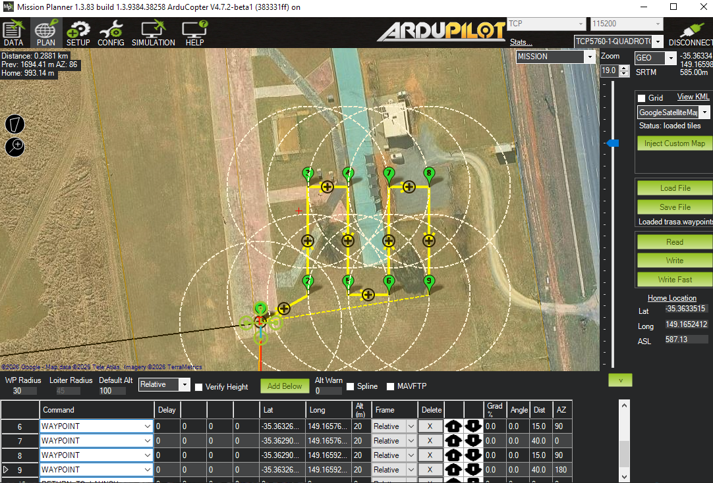

# Autonomiczna misja drona


Autor: Julia Wierzbicka 


.

[Awarie w Mission Plannerze (film)](https://drive.google.com/file/d/1cnelmbGfTy-NOu4XVmemNjnMwPisvn23/view?usp=sharing).


[Misja ze zrzutem ładunku w Mission Plannerze](docs/misja-zrzut-mission-planner.png) 

[Pełna misja w symulatorze] https://drive.google.com/file/d/1bxbqcKp4sBbboGS7KH68qY9peaoHYRbK/view?usp=sharing 

 

## Spis treści 

1. [Koncepcja misji](#1-koncepcja-misji) 

2. [Przebieg prawidłowego scenariusza](#2-przebieg-prawidłowego-scenariusza) 

3. [Architektura](#3-architektura) 

4. [Struktura repozytorium i dane testowe](#4-struktura-repozytorium-i-dane-testowe) 

5. [Instrukcja uruchomienia](#5-instrukcja-uruchomienia) 

6. [Uruchomienie symulacji w Mission Plannerze (SITL)](#6-uruchomienie-symulacji-w-mission-plannerze-sitl) 

7. [Uruchomienie testów](#7-uruchomienie-testów) 

8. [Scenariusze testowe i oczekiwane wyniki](#8-scenariusze-testowe-i-oczekiwane-wyniki) 

9. [Przyjęte uproszczenia](#9-przyjęte-uproszczenia) 

10. [Pomysły na dalszy rozwój](#10-pomysły-na-dalszy-rozwój) 

11. [Wykorzystane źródła i narzędzia](#11-wykorzystane-źródła-i-narzędzia) 

 

## 1. Koncepcja misji 


**Misja "poszukiwanie celu i zrzut"** Dron ma za zadnianie, żeby znaleźć w zadanym obszarze czerwony kwadrat (cel) i zrzucić na niego ładunek - najpierw przeszukuje teren, wychwytuje cel, sprawdza poprawnoość i dokonuje zrzutu. 

przygotowanie → start → szukanie → potwierdzanie (nie) → szukanie → potwierdzanie → zrzut → powrót → koniec


Działanie:
 1. Przygotowanie - program łączy się z autopilotem, tryb GUIDED

 2. Start - uzbrojenie (ARM), TAKEOFF, wzniesienie na wysokość 20 m  

 3. Szukanie celu - przelot nad obszarem lub trasą, czyli obszarem 60 m x 40 m, zagęszczoną co 5 m (kamera sprawdza czy widzi cel), wirtualna kamera z polem widzenia 60 stopni, szumem pozycji, chybieniami i fałszywymi alarmami  

 4. Potwierdzemie celu - dron podlatuje w potencjalne miejsce i sprawdza 3 razy. Jeśli 2/3 bedą się zgadzały cel zostaje potwierdzony - odrzuca fałszywe alarmy, potem zrzut nad celem albo dalsze poszukiwanie, gdy cel nie potwierdzony (wraca spowrotem na trasę)  

 5. Powrót i lądowanie - tryb RTL, czekanie na rozbrojenie po lądowaniu (DISARM) 

 

Poza prawidłowym przebiegiem misji obsługiwane są też sytuacje takie jak brak celu, fałszywą detekcje, słaba bateria, utrata GPS i łączności, 
przekroczenie limitu czasu, wyjście poza strefę, a także błędy samego drona. Sprawdza je przed każdym punktem trasy monitor bezpieczeństwa. Kiedy nastąpi alarm, czyli coś jest nie tak - dron wraca do bazy bez zrzutu. Kiedy utracił GPS ląduje w obecnym miejscu.

 

**Kamera jest zasymulowana**, bo symulator ArduPilota nie ma obrazu. Czujnik jest ukryty za interfejsem `Czujnik`, więc prawdziwą kamerę z algorytmem 
detekcji można podłączyć bez zmian w logice misji. 

 

## 2. Przebieg prawidłowego scenariusza 

1. **Przygotowanie** Program łączy się z autopilotem, zapamiętuje pozycję startową, przełącza tryb na GUIDED i uzbraja silniki. 

2. **Start** Dron wznosi się na 20 m. 

3. **Szukanie** Dron leci po kolejnych punktach trasy. W każdym punkcie kamera sprawdza, czy widzi cel -przed każdym punktem monitor bezpieczeństwa sprawdza 

   baterię, GPS, łączność, strefe, czas. 

4. **Potwierdzanie** Gdy kamera coś zauważy, dron podlatuje do potencjalnego miejsca zrzutu i patrzy na niego 3 razy. Cel jest uznany, jeśli co najmniej 2 z 3 się zgadzają. 

   Inaczej to fałszywy alarm i dron wraca na trasę do szukania. 

5. **Zrzut** Dron dolatuje nad uśrednioną pozycję celu (tolerancja 2 m) i zrzuca ładunek - serwo na wyjściu 9 ustawia 1900 µs. Program czeka na potwierdzenie 

   z telemetrii (SERVO_OUTPUT_RAW). 

6. **Powrót i lądowanie** Tryb RTL, dron wraca do bazy, ląduje i silniki zostają rozbrojone. 

7. **Raport** Program zapisuje `output/raport.json` (wynik, historia stanów, czas, pozycja celu i zrzutu). 

 

Schemat prawidłowej misji (z jednym fałszywym alarmem): 

przygotowanie → start → szukanie → potwierdzanie (nie) → szukanie → potwierdzanie → zrzut → powrót → koniec

 
W symulatorze zrzut ląduje ok. 0,5 do 2 m od prawdziwego celu (zależy od szumu kamery). 


## 3. Architektura

Program składa się z kilku niewielkich modułów. Całą misję prowadzi Misja, czyli maszyna stanów z pliku state_machine.py. Aby sterować dronem, odczytywać czujnik i mierzyć czas, korzysta z trzech interfejsów: Pojazd, Czujnik i Zegar. Interfejs określa tylko to co dany element ma potrafić, bez wskazywania, jak to robi. Dzięki temu ten sam kod misji może pracować z symulatorem w Mission Plannerze i z atrapą drona w testach.

### Schemat zależności

```text
scripts/misja.py ------------> Misja
scripts/scenariusz.py -------> mission/scenariusz.py --> Misja
                               (wczytuje YAML, wstrzykuje awarie, sprawdza wynik)

Misja (state_machine.py) korzysta z:
  - safety.py ........ monitor bezpieczeństwa (sprawdza alarmy przed każdym punktem)
  - raport.py ........ zapis raportu JSON
  - Pojazd ........... interfejs
        - MavlinkPojazd (pymavlink) --> ArduCopter SITL / Mission Planner
        - AtrapaDrona (testy)
  - Czujnik .......... interfejs
        - WirtualnaKamera --> cele z data/cele.yaml
  - Zegar ............ interfejs
        - ZegarSystemowy
        - ZegarSztuczny (testy)

Scenariusze awarii: config/scenarios/*.yaml (czyta je mission/scenariusz.py)
```

Legenda:
strzałka `-->` znaczy „korzysta z” albo „rozmawia z”, a punktory pod interfejsem to jego konkretne wersje. Prawdziwy dron z symulatora (`MavlinkPojazd`) i atrapa (`AtrapaDrona`) spełniają tę samą umowę `Pojazd`, więc misja nie wie, z którym z nich pracuje.


Kluczowe decyzje projektowe:
 
- **Interfejsy i atrapy** - logika misji nie wie, czy rozmawia z symulatorem, czy z atrapą. Dzięki temu ten sam kod przechodzi testy bez symulatora, a w Mission Plannerze 

  leci naprawdę. Tylko `vehicle.py` zna MAVLink. 

- **Maszyna stanów** - każdy stan to jedna metoda, która coś robi i zwraca stan następny. Historia stanów trafia do raportu, więc w teście widać, jak przebiegła misja. 

- **Monitor bezpieczeństwa jako funkcja** - `sprawdz(telemetria, pozycja, dom, czas, limity)` zwraca alarm albo nic. Kolejność ważności: łączność, GPS, bateria, strefa, czas. 

  Utrata GPS kończy się lądowaniem w miejscu (bez GPS powrót jest niemożliwy), pozostałe alarmy powrotem do bazy. 

- **Zegar jako zależność** - misja pyta obiekt `Zegar` o czas. W testach `ZegarSztuczny` płynie tylko wtedy, gdy atrapa zgłosi czas komendy, więc test 10-minutowej misji trwa milisekundy. 

- **Scenariusze to dane** - plik YAML opisuje, co jest w obszarze, co i kiedy się psuje oraz czego oczekujemy. Nowy scenariusz to nowy plik, bez pisania kodu. 

- **Powtarzalność** - kamera ma ziarno losowości (`seed`), te same dane dają ten sam przebieg. 

 

 Plik i za co odpowiada

 `src/mission/vehicle.py`  interfejs `Pojazd`, implementacja `MavlinkPojazd` (jedyne miejsce z MAVLinkiem), wstrzykiwanie awarii w symulatorze  

 `src/mission/atrapy.py`  `AtrapaDrona` (drona nie ma, ale komendy trwają i można go "zepsuć"), `CzujnikZeSkryptem`  

 `src/mission/state_machine.py`  maszyna stanów `Misja`, wynik `WynikMisji`  

 `src/mission/safety.py`  monitor bezpieczeństwa: alarmy, limity, dozwolona strefa  

 `src/mission/sensors/simulated_camera.py`  `WirtualnaKamera` i wczytywanie celów z YAML  

 `src/mission/planner.py`  trasa, zagęszczanie punktów, eksport `.waypoints` dla Mission Plannera  

 `src/mission/geo.py`  przeliczanie metrów na współrzędne i odległości  

 `src/mission/zegar.py`  zegar systemowy i sztuczny  

 `src/mission/raport.py`  raport JSON i podsumowanie 

 `src/mission/scenariusz.py`  wczytywanie i uruchamianie scenariuszy, sprawdzanie oczekiwań  

 

**Komunikacja z autopilotem** (MAVLink, biblioteka pymavlink, połączenie TCP): tryb GUIDED, uzbrojenie (`MAV_CMD_COMPONENT_ARM_DISARM`), start (`MAV_CMD_NAV_TAKEOFF`), 

lot do punktu (`SET_POSITION_TARGET_GLOBAL_INT`, układ z wysokością względną), zrzut (`MAV_CMD_DO_SET_SERVO` z potwierdzeniem w `SERVO_OUTPUT_RAW`), tryby RTL i LAND, 

telemetria z `GLOBAL_POSITION_INT`, `SYS_STATUS`, `GPS_RAW_INT` i `HEARTBEAT`. Każda czynność ma limit czasu i kończy się błędem `BladPojazdu`, a nie zawieszeniem programu. 

 

## 4. Struktura repozytorium i dane testowe 

'''autonomiczna_misja_drona/ 

├─ config/scenarios/        8 scenariuszy testowych w YAML (dane testowe: cele, awarie, oczekiwane wyniki) 

├─ data/cele.yaml           cele do znalezienia (pozycje w metrach od startu drona) 

├─ docs/                    zrzuty ekranu i przykładowy raport 

├─ scripts/ 

│  ├─ misja.py              pełna misja (symulator albo atrapa) 

│  ├─ scenariusz.py         uruchamianie scenariuszy (symulator albo atrapa) 

│  ├─ lec_trase.py          sam przelot po trasie (wcześniejszy etap) 

│  └─ hello_drone.py        pierwszy skrypt: uzbrój, wystartuj, wyląduj (prototyp) 

├─ src/mission/             kod źródłowy (sekcja 3) 

├─ tests/unit/              testy automatyczne 

├─ pyproject.toml           zależności i konfiguracja pytest 

└─ requirements.txt         skrót do instalacji: pip install -r requirements.txt 

``` 

 

Dane testowe: `data/cele.yaml` (jeden czerwony kwadrat 30 m na północ i 45 m na wschód od startu, w obszarze szukania) oraz 8 plików w `config/scenarios/`. 

Przykładowy wynik misji: `[docs/przykladowy_raport.json](docs/przykladowy_raport.json)`. Plik `output/trasa.waypoints` (trasa do wczytania w Mission Plannerze) i inne pliki 

w `output/` powstają przy każdym uruchomieniu i nie są w repozytorium. 

 

## 5. Instrukcja uruchomienia

**Wymagania:** Python musi byc w wersji conajmniej 3.12 , Git. Do lotów w symulatorze także Mission Planner. 


**Instalacja (Windows, PowerShell):** 


```powershell 

git clone https://github.com/JuliaW600/autonomiczna_misja_drona.git 

cd autonomiczna_misja_drona 

py -3.12 -m venv .venv 

.\.venv\Scripts\Activate.ps1 

pip install -e ".[dev]" 

``` 

 

Jeśli PowerShell odmawia uruchomienia `Activate.ps1`, wpisz  `Set-ExecutionPolicy -Scope CurrentUser RemoteSigned` i powtórz. 
 

**Instalacja (Linux / macOS):** 
 

```bash 

git clone https://github.com/JuliaW600/autonomiczna_misja_drona.git 

cd autonomiczna_misja_drona 

python3 -m venv .venv 

source .venv/bin/activate 

pip install -e ".[dev]" 

``` 

 

Na początku linii poleceń powinno pojawić się `(.venv)`. Instalacja pobiera `pymavlink`, `pyyaml` i `pytest`. 

 

**Misja bez symulatora (atrapa drona), od razu po instalacji:** 
 

``` 

python scripts/misja.py --atrapa 

``` 


Oczekiwany koniec wyniku: `Wynik misji: SUKCES (cel znaleziony i ładunek zrzucony)`, linia `Zrzut ... m od prawdziwego celu` i `Raport zapisany: output/raport.json`. 

 

**Przydatne opcje `scripts/misja.py`:** `--bez-celu` (kamera nie ma czego znaleźć), `--alt` (wysokość), `--fov` (kąt widzenia kamery), `--szerokosc` i `--glebokosc` (obszar), 

`--krok` (co ile metrów kamera się rozgląda), `--falszywe` (częstość fałszywych alarmów), `--seed` (ziarno losowości), `--max-czas` (limit czasu misji), `--raport` (plik raportu). 

Pełna lista: `python scripts/misja.py --help`. 

 

## 6. Uruchomienie symulacji w Mission Plannerze (SITL) 

Potrzebny: **Mission Planner** dla Windows ([instalator](https://ardupilot.org/planner/docs/mission-planner-installation.html)). Użyta wersja: Mission Planner 1.3.83, 

symulator ArduCopter 4.7.2-beta1. Opis symulatora: [Mission Planner Simulation](https://ardupilot.org/planner/docs/mission-planner-simulation.html). 

 

1. Uruchom Mission Planner. W prawym górnym rogu sprawdź, że nie jesteś połączony z niczym innym. 

2. Wybierz zakładkę **SIMULATION** i kliknij ikonę **Multirotor**. Za pierwszym razem program pobierze symulator (potrzebny internet). Po chwili Mission Planner sam połączy się 

   z wirtualnym dronem, a na zakładce **DATA** zobaczysz mapę z dronem w Canberze (współrzędne -35.363, 149.165). 

3. Na zakładce **DATA** zaznacz **Auto Pan**, żeby mapa podążała za dronem. 

4. W terminalu (z aktywnym `(.venv)`) w folderze projektu uruchom: 
 

``` 

python scripts/misja.py --connect tcp:127.0.0.1:5762 

``` 


Mission Planner zajmuje port 5760, dlatego program łączy się z drugim portem symulatora, **5762**. Na mapie widać start, przelot, zrzut i powrót. 

Przed każdą misją program sam przywraca w symulatorze baterię i GPS, więc kolejne uruchomienia nie psują się nawzajem. 

 

**Scenariusze awaryjne w symulatorze** (każdy osobno, symulator może być włączony cały czas): 

``` 

python scripts/scenariusz.py config/scenarios/04_slaba_bateria.yaml --connect tcp:127.0.0.1:5762 

python scripts/scenariusz.py config/scenarios/05_utrata_gps.yaml --connect tcp:127.0.0.1:5762 

python scripts/scenariusz.py config/scenarios/08_poza_obszarem.yaml --connect tcp:127.0.0.1:5762 

python scripts/scenariusz.py config/scenarios/07_przekroczony_czas.yaml --connect tcp:127.0.0.1:5762 

``` 

 

Albo wszystkie jedną komendą: `python scripts/scenariusz.py --wszystkie --connect tcp:127.0.0.1:5762` (scenariusze tylko-atrapa zostaną pominięte). 

Awarie są wywoływane parametrami symulatora (`SIM_BATT_VOLTAGE`, `SIM_GPS1_ENABLE`), więc w Mission Plannerze widać zmianę trybu lotu (GUIDED, potem RTL albo LAND) na HUD. 

 

**Uwaga o limicie czasu.** Scenariusz `przekroczony_czas` ma limit 40 s, dobrany do symulatora w normalnym tempie. Gdy symulator działa szybciej, misja skończy się przed limitem 

i scenariusz wyjdzie `NIEZALICZONY`. Wtedy dodaj `--limit-czasu 15`. 

 

**Trasa w Mission Plannerze.** `python scripts/lec_trase.py` albo `scripts/misja.py` zapisują trasę do `output/trasa.waypoints`. Można ją wczytać w zakładce **PLAN** 

(**Load WP File**), żeby obejrzeć na mapie. 

 

## 7. Uruchomienie testów 

``` 

pytest 

``` 
 

Testy nie wymagają symulatora ani internetu i trwają bardzo krótko. Aktywny musi być `(.venv)`. Spodziewany wynik: ostatnia linia `... passed in ...s`, bez żadnego `failed`. Szczegółowa lista: `pytest -v`. 

 

 Pliki testów i co sprawdzają  

 `test_geo.py`, `test_planner.py`, `test_geo_planner_dodatki.py`  przeliczanie współrzędnych, trasa, zagęszczanie, eksport `.waypoints`  

 `test_kamera.py`  pole widzenia, szum, chybienia i fałszywe alarmy kamery, powtarzalność przy tym samym seed  

 `test_state_machine.py`  przebieg misji - sukces, brak celu, fałszywe alarmy oraz błędy drona (uzbrojenie, lot, zrzut, powrót)  

 `test_safety.py`  każdy alarm i każdy próg, priorytety alarmów  

 `test_state_machine_bezpieczenstwo.py`  reakcja misji na alarmy

 `test_zegar.py`, `test_raport.py`  zegar sztuczny, raport JSON  

 `test_scenariusze.py`  wczytywanie scenariuszy YAML i wynik każdego z 8 scenariuszy na atrapie  

 `test_dokumentacja.py`  README

 

Jedna komenda sprawdza wszystkie scenariusze na atrapie (bez symulatora): 


``` 

python scripts/scenariusz.py --wszystkie --atrapa 

``` 

 
Oczekiwane to 8 razy `ZALICZONY`. Testy są powtarzalne.

 

## 8. Scenariusze testowe i oczekiwane wyniki 

Każdy scenariusz to plik YAML w `config/scenarios/` z opisem, awarią i oczekiwanym wynikiem. Program porównuje faktyczny przebieg z oczekiwanym i wypisuje `ZALICZONY` albo `NIEZALICZONY`. 
 

 Scenariusz - Co się dzieje - Oczekiwany wynik - Gdzie  

 `normalny` - cel na trasie, jeden fałszywy alarm po drodze  fałszywy alarm odrzucony, cel potwierdzony, zrzut, powrót, wynik `SUKCES`  atrapa i symulator  

 `brak_celu` - w obszarze nie ma celu  cała trasa przeszukana, bez zrzutu, powrót, `NIE_ZNALEZIONO`  atrapa i symulator  

 `falszywe_alarmy`- kamera często zgłasza nieistniejący cel,  każdy alarm sprawdzony i odrzucony, bez zrzutu, `NIE_ZNALEZIONO`  tylko atrapa  

 `slaba_bateria`-  po 10 punktach trasy napięcie 10 V  alarm `SLABA_BATERIA`, powrót do bazy bez zrzutu, `PRZERWANA`  atrapa i symulator  

 `utrata_gps` - po 10 punktach znika GPS  alarm `UTRATA_GPS`, lądowanie w miejscu, `PRZERWANA`  atrapa i symulator  

 `utrata_lacznosci` - po 10 punktach brak sygnału z drona  alarm `UTRATA_LACZNOSCI`, próba powrotu, `PRZERWANA`  tylko atrapa  

 `przekroczony_czas` - limit czasu misji 40 s  alarm `PRZEKROCZONY_CZAS`, powrót, `PRZERWANA`  atrapa i symulator  

 `poza_obszarem` - dozwolona strefa węższa niż trasa  alarm `POZA_OBSZAREM`, powrót, `PRZERWANA`  atrapa i symulator  

 

Do tego testy jednostkowe sprawdzają awarie samego drona - nieudane uzbrojenie, awaria podczas lotu, nieudany zrzut, nieudany powrót i nieudane lądowanie awaryjne. 

 

**Co sprawdzono w symulatorze**
W Mission Plannerze przetestowano 4 sytuacje awaryjne -  slaba_bateria, utrata_gps, poza_obszarem, przekroczony_czas. 
Każda z nich została zaliczona. 


**Symulator i atrapa** 
W SITL da się wiarygodnie przetestować: start, lot po trasie, zrzut (serwo), tryby RTL i LAND, słabą baterię i utratę GPS (przez parametry symulatora). 

Na atrapie testujemy to, czego SITL nie potrafi lub nie jest powtarzalnie - utratę łączności, fałszywe alarmy kamery (losowe, w SITL wynik byłby przypadkowy) i błędy pojedynczych komend. 

 

## 9. Przyjęte uproszczenia

- **Kamera jest zasymulowana** Nie ma obrazu ani algorytmu wizyjnego. Wirtualna kamera zna pozycje celów i zwraca je z szumem, chybieniami i fałszywymi alarmami. Patrzy idealnie w dół bez przechyłów drona. 

- **Cel jest punktem** Nie ma rozmiaru i koloru. 

- **Zrzut to ustawienie serwa** Nie ma fizyki spadającego ładunku (wiatr, czas opadania). Zrzut następuje z pozycji nad celem. 

- **Alarmy są sprawdzane między krokami**, czyli przed każdym punktem trasy, a nie w trakcie lotu do jednego punktu. Alarm w środku odcinka wywoła reakcję dopiero po dolocie. 

- **Awarie w symulatorze są sztuczne** To zmiany parametrów `SIM_...`, a nie prawdziwe rozładowania baterii czy zakłócenia GPS. 

- **Utraty łączności nie da się wywołać w Mission Plannerze** - ten scenariusz działa tylko na atrapie. 

- **Potwierdzanie celu (2 / 3 spojrzeń) zmniejsza liczbę fałszywych alarmów, ale ich nie eliminuje.** Przy częstych fałszywych alarmach dwa spojrzenia mogą przypadkiem się zgodzić. 

- **Brak wiatru, przeszkód i innych statków powietrznych**, stała wysokość lotu 20 m, jeden dron, jeden cel naraz. 

- **Czas w scenariuszu limitu czasu zależy od tempa symulatora** (opisane w sekcji 6). 

- **Testy ze SITL nie są częścią `pytest`** Loty w symulatorze uruchamia się ręcznie, bo wymagają Mission Planner. Automatycznie testowana jest cała logika na atrapie. 

 

## 10. Pomysły na dalszy rozwój 

- Prawdziwa kamera i detektor (np. wykrywanie koloru w OpenCV) za istniejącym interfejsem `Czujnik`, najpierw na nagraniach lub zdjęciach z drona. 

- Zrzut z uwzględnieniem wiatru i czasu opadania ładunku (wyprzedzenie pozycji zrzutu). 

- Sprawdzanie alarmów także w trakcie lotu do punktu (osobny wątek lub pętla zdarzeń). 

- Kilka celów i wybór kolejności zrzutów, planowanie trasy na podstawie wyników wstępnego przelotu. 

- Wersja dla samolotu (ArduPlane): inna trasa, lądowanie z podejściem, zrzut z przelotu. 

- Wizualizacja raportów i porównywanie przebiegów (np. mapa trasy z punktem zrzutu). 

 

## 11. Wykorzystane źródła i narzędzia 
**Biblioteki i narzędzia zewnętrzne** 

 [ArduPilot / ArduCopter](https://ardupilot.org/copter/) i jego symulator SITL  autopilot i symulacja drona  GPLv3  

 [Mission Planner](https://ardupilot.org/planner/)  stacja naziemna i uruchomienie symulatora  GPLv3  

 [pymavlink](https://github.com/ArduPilot/pymavlink)  komunikacja MAVLink  LGPLv3  

 [PyYAML](https://pyyaml.org/)  odczyt scenariuszy i celów  MIT  

 [pytest](https://pytest.org/)  testy  MIT  

 [Dokumentacja MAVLink](https://mavlink.io/en/) i [ArduPilot](https://ardupilot.org/dev/)  typy komend i parametry symulatora   

Korzystałam z AI (Claude Sonnet/Opus) do pisania części kodu i testów oraz instrukcji i części README. Wspomagałam się AI kiedy natrafiałam na problem którego nie byłam w stanie rozwiązać samodzielnie.

 
